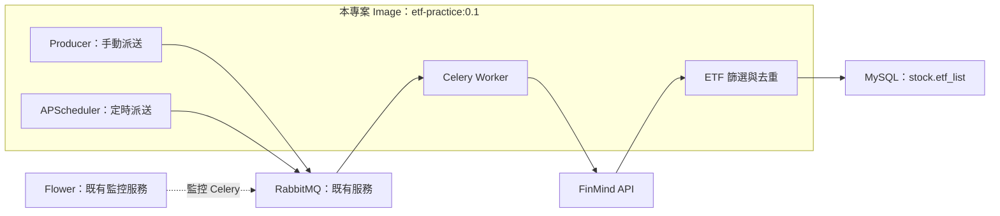

# linhsuteng-etflist-crawler

從 FinMind API 收集並篩選台股 ETF 清單，排除主動式、槓桿型及反向型 ETF。

使用 Python 擷取與篩選資料，以 Celery 執行任務、RabbitMQ 傳遞訊息、MySQL 儲存結果，並以 Docker Compose 與 APScheduler 串接執行流程。

## 架構



- Worker 透過外部網路 `crawler_dev` 連線至 `rabbitmq:5672`，透過 `my_network` 連線至 `mysql:3306`。
- RabbitMQ、MySQL、Flower 由課程環境另外管理，本專案的 Compose 不會建立這些服務。
- Producer 與 Scheduler 只需要 broker 連線；資料庫密碼由 Worker 使用，不放入任務訊息。

## 環境與檔案

- Python ≥ 3.11、uv 0.12.13
- Celery 5.5.0、Flask 3.1.0、APScheduler 3.11.3
- PyMySQL（含 RSA 支援）≥ 1.2.3、Requests ≥ 2.34.2
- Docker Engine 與 Docker Compose

| 檔案／模組 | 用途 |
| --- | --- |
| `crawler/save_etf_list.py` | 將篩選結果逐筆寫入 MySQL |
| `crawler/tasks.py` | Celery 任務；從環境變數讀取 MySQL 密碼 |
| `crawler/run_worker.py` | 本機執行入口；使用 getpass，RabbitMQ 固定連至 127.0.0.1 |
| `crawler.producer` | 手動派送任務 |
| `crawler.scheduler` | APScheduler 定時派送任務 |
| `Dockerfile` | 建立 Python 3.11 slim 應用映像檔 |

Docker build 使用 `uv sync --frozen --no-dev --no-install-project`，以鎖定檔安裝套件，將 `.venv/bin` 加入 PATH，並以非 root 的 `appuser` 執行。`.dockerignore` 採允許清單，限制進入 build context 的檔案。

## ETF 篩選規則

資料來源為 FinMind 的 `TaiwanStockInfo`、`TaiwanStockActiveETFInfo`、`TaiwanStockDelisting`。

1. 同一 `stock_id` 保留日期最新的一筆。
2. 保留產業分類包含 `ETF`，且市場為 `twse` 或 `tpex` 的候選資料。
3. 排除主動式 ETF 名單中的代碼。
4. 排除長度為 6 碼，且第 6 碼為 `L`、`M`、`R`、`S` 的代碼。
5. 排除下市日期小於或等於執行當日（Asia/Taipei）的代碼。

2026-10-03（台北時間）測試快照：原始資料 4,329 筆，ETF 候選 422 筆，依序排除 40、52、52 筆，保留 278 筆。筆數會隨來源更新而改變。

注意：來源的 `date` 是資料更新日期，不能當作最後交易日。此流程也未完整處理代碼重用或重新上市情境，不保證涵蓋所有例外。

## MySQL 前置設定

請先由資料庫管理者建立 `stock` 資料庫及 `etf_list` 資料表，並讓執行帳號具備此表需要的 SELECT、INSERT、UPDATE 權限。以下是建表參考，不包含帳號密碼，也不會清空既有資料：

```sql
CREATE DATABASE IF NOT EXISTS stock
  CHARACTER SET utf8mb4 COLLATE utf8mb4_unicode_ci;

CREATE TABLE IF NOT EXISTS stock.etf_list (
    stock_id VARCHAR(20) NOT NULL PRIMARY KEY,
    stock_name VARCHAR(100) NOT NULL,
    industry_category VARCHAR(100) NOT NULL,
    market VARCHAR(10) NOT NULL,
    source_date DATE NOT NULL,
    last_seen_at DATETIME NOT NULL DEFAULT CURRENT_TIMESTAMP
) ENGINE=InnoDB CHARACTER SET utf8mb4 COLLATE utf8mb4_unicode_ci;
```

`stock_id` 是主鍵；同代碼再次執行會更新資料。程式使用參數化 SQL 與明確的 `execute` 迴圈，全部成功後 commit，遇到錯誤則 rollback。`last_seen_at` 儲存台北時間，不附時區資訊。

程式不刪除本次未出現的代碼，因此資料表會保留舊資料，不能直接視為當下完整且有效的 ETF 名單。既有課程帳號仍有 `mydb` 權限，本次設定不代表已完成整個帳號的最小權限調整。

## 連線設定

| 環境變數 | 用途／設定 |
| --- | --- |
| `MYSQL_HOST` | 本機預設 `127.0.0.1`；Compose 使用 `mysql` |
| `MYSQL_PORT` | 本機預設 `3307`；Compose 使用 `3306` |
| `MYSQL_USER` | 預設 `user` |
| `MYSQL_DATABASE` | 預設 `stock` |
| `MYSQL_PASSWORD` | Worker 執行時讀取；請自行提供 |
| `RABBITMQ_HOST` | Compose 使用 `rabbitmq` |
| `RABBITMQ_PORT` | Compose 使用 `5672` |
| `WORKER_ACCOUNT`、`WORKER_PASSWORD` | RabbitMQ 帳號與密碼 |
| `SCHEDULE_SECONDS` | 預設 `43200`（12 小時），最小值 `60` |

課程環境的 broker 範例預設值為 `worker`／`worker`，僅供練習。若使用自己的服務，請改成實際設定，不要提交真實密碼或含密碼的檔案。

## 本機執行

在 WSL 專案目錄安裝鎖定版本的依賴：

```bash
cd ~/etf-practice
uv sync --frozen
```

只擷取及篩選清單，或直接寫入 MySQL：

```bash
uv run python -m crawler.finmind_etf_list
uv run python -m crawler.save_etf_list
```

寫入前請先完成資料庫、資料表與權限設定。本機預設連至 `127.0.0.1:3307`，使用者預設為 `user`，資料庫為 `stock`；需要時可用前述環境變數調整。

本機 Worker 與 Docker Worker 測試請擇一執行，避免另一個 Worker 領走同一佇列的任務。

在本機啟動 Celery Worker：

```bash
uv run python -m crawler.run_worker
```

依提示提供本機所需密碼。此入口使用 getpass 隱藏輸入，RabbitMQ 主機固定為 `127.0.0.1`，適用於本機練習；Docker 請使用下面的 Compose 流程。

## Docker 執行

以下指令在專案根目錄執行。測試環境位於 WSL 的 `~/etf-practice`。

### 1. 確認既有服務與網路

```bash
docker network inspect crawler_dev my_network
```

必須先具備兩個外部網路、可連線的 RabbitMQ 與 MySQL，以及前述資料表與帳號權限。請確認 RabbitMQ 在 `crawler_dev` 上有 `rabbitmq` alias，MySQL 在 `my_network` 上有 `mysql` alias。

### 2. 建置映像檔並啟動 Worker

```bash
docker build -t etf-practice:0.1 .
read -r -s -p 'MySQL user password: ' MYSQL_PASSWORD
echo
export MYSQL_PASSWORD
docker compose up -d worker
```

密碼透過執行環境提供，仍可由具有 Docker 管理權限的人員查看；請勿把環境變數或容器檢查結果完整貼到公開位置。

### 3. 手動派送與查看結果

```bash
docker compose run --rm producer
docker compose logs --tail 25 worker
```

可在已登入的 MySQL 用戶端確認筆數與中文資料。若命令列中文顯示問號，先設定該次連線字元集：

```sql
SET NAMES utf8mb4;
SELECT COUNT(*) FROM stock.etf_list;
SELECT stock_id, stock_name, market, source_date, last_seen_at
FROM stock.etf_list
ORDER BY stock_id
LIMIT 10;
```

### 4. 短時間測試排程

```bash
docker compose run --rm -e SCHEDULE_SECONDS=60 scheduler
```

等待約 60 秒，確認排程已派送、Worker 執行成功後按 Ctrl+C 結束測試。Scheduler 以啟動時間為基準計算間隔，啟動時不立即派送；同一排程設定 `max_instances=1`、`coalesce=True`。

Producer 使用 `tools` profile，Scheduler 使用 `schedule` profile；直接執行指定服務的 `docker compose run` 可啟用該服務。所有服務均設定 `restart: "no"`。

需要常駐的 12 小時排程時，可另外執行：

```bash
docker compose --profile schedule up -d scheduler
```

結束本專案容器：

```bash
docker compose --profile schedule down
unset MYSQL_PASSWORD
```

外部網路與另外管理的 RabbitMQ、MySQL、Flower 不由此命令刪除。

## 驗證與發布狀態

已驗證（2026-10-03，台北時間）：

- Docker 手動派送任務成功。
- 60 秒 APScheduler 測試成功派送並完成任務，測試後已停止。
- 在主機執行並查詢 MySQL，已確認重複執行後仍為 278 筆，中文儲存正常。
- Docker 手動與排程任務的成功日誌確認提交 278 筆；Docker 執行後尚未另外以 SQL 查詢驗證資料表。
- 預設 12 小時排程尚未常駐執行。

交付位置：

- GitHub：`tibameDataEngineer1150701/linhsuteng-etflist-crawler`，本次開發分支 `practice/passive-etf`。
- Docker Hub：`antonlin0726/etf-practice:0.1`，已於 2026-10-03 上傳。儲存庫依本次設定採 Private，下載者須先登入並取得適當存取權限；教師驗收權限需另確認。
- 上傳 digest：`sha256:0cd5a282edda8b541b8b82da3f536400cb32de194318b722ec1d47c8f3174ace`。

有私人儲存庫權限時，可下載並加上目前 Compose 使用的本機標籤：

```bash
docker login
docker pull antonlin0726/etf-practice:0.1
docker tag antonlin0726/etf-practice:0.1 etf-practice:0.1
```

本專案用於課程練習與資料流程驗證，資料需依來源狀態與篩選限制解讀，不作為投資建議。
